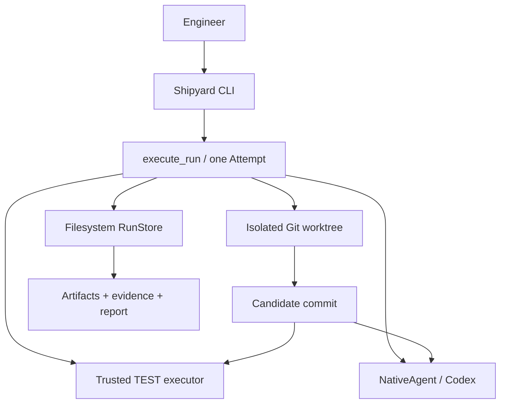
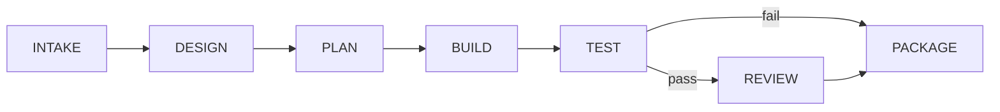
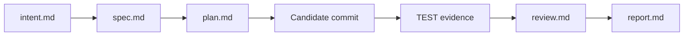
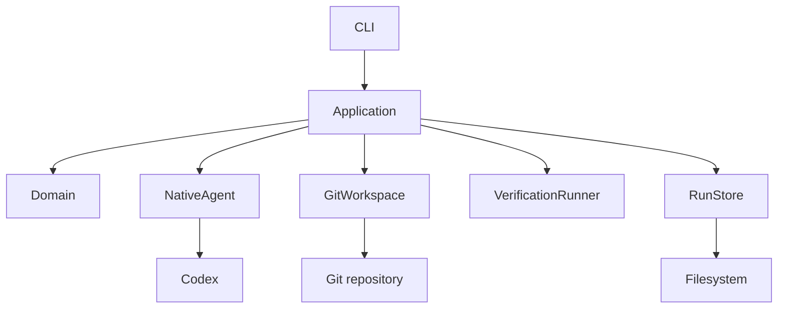

# Shipyard Architecture

This document describes the **Shipyard execution core** and the completed Phase 11 local rework/recovery workflow. Broader Product infrastructure remains out of scope.

Phases 2–8 are complete: frozen intake, methodology/routing, independent
native-agent execution, Git candidates, trusted TEST, revision-bound REVIEW/VERIFIED,
and synchronous Run execution with terminal PACKAGE.
See the [Phase 8 audit](spec/045-phase8-acceptance-audit/report.md).

## Bird's Eye View

Shipyard accepts a Markdown file or GitHub Issue, freezes the Run contract,
executes one canonical playbook around a native coding agent, verifies the
resulting Git commit, and writes durable evidence to the local filesystem.
The CLI submits to a local background service by default; `--foreground` invokes
the same synchronous execution core in the client process.



## Technology choices

The local MVP uses a small stack:

- Python 3.14
- `uv` for dependency and environment management
- Typer + Rich for the CLI
- Pydantic for structured domain and stage contracts
- PyYAML for `shipyard.yaml`
- system `git` and external tools via subprocess
- Codex CLI behind the `NativeAgent` boundary
- filesystem-backed persistence
- pytest, Ruff, and Pyright for validation

The execution core uses no web framework, database or cloud infrastructure. Phase 10 adds a local service around that core; see [the service contract](docs/background-control-plane.md).

## Architecture Invariants

1. The execution core has one playbook: `bounded-repository-change`.
2. Its stages are `INTAKE → DESIGN → PLAN → BUILD → TEST → REVIEW → PACKAGE`.
3. DESIGN, PLAN, BUILD, and REVIEW use fresh native-agent invocations.
4. `spec.md` is the correctness contract; `plan.md` is implementation guidance.
5. BUILD may update the plan but may not silently rewrite the spec.
6. BUILD produces an exact candidate Git commit before TEST.
7. Verification belongs to the exact candidate SHA.
8. TEST is Shipyard-controlled and authoritative. Any mandatory failure produces `TEST_FAILED`; REVIEW does not run.
9. REVIEW is independent, read-only, and evaluates the exact candidate against `spec.md` and TEST evidence.
10. Required criteria are `PASS`, `FAIL`, or `UNVERIFIED`. Only all-`PASS` can produce `VERIFIED`.
11. Workflow state comes from validated structured stage results, never prose inference.
12. The Run freezes input intent, base SHA, playbook/skills, verification configuration, agent profile, and execution budget.
13. `shipyard.yaml` is read from the frozen base revision; BUILD cannot change how its candidate is judged.
14. The PoC is trusted-local. Git worktrees isolate workspace state but are not a security boundary.
15. Every terminal result produces `report.md` and machine-readable evidence.
16. Terminal Shipyard records and evidence are immutable; retained checkout data is separate.

## Execution Flow



| Stage | Responsibility | Main output |
|---|---|---|
| INTAKE | Freeze source intent | `intent.md` |
| DESIGN | Define what must be true | `spec.md` + stage result |
| PLAN | Define implementation approach | `plan.md` + stage result |
| BUILD | Implement and create candidate commit | candidate SHA + stage result |
| TEST | Run all mandatory `shipyard.yaml` checks | deterministic evidence |
| REVIEW | Independently assess required criteria | `review.md` + stage result |
| PACKAGE | Finalize human and machine evidence | `report.md`, `evidence.json` |

PACKAGE is outside the normal execution budget and runs for every terminal outcome.

## Input and CLI

The CLI accepts local Markdown (`file:./issue.md`) or GitHub Issues
(`github:owner/repo#42`). Source-mode `run` captures once with `create_run`, then submits the saved
contract locator to the service. `--foreground` composes capture and
`execute_run` directly. `intake` captures
without execution; `inspect` and `methodology` are read-only.

The CLI owns parsing, configuration selection, presentation and exit codes.
Workflow and verification rules belong to the application and domain layers.
See [usage](docs/usage.md), [configuration](docs/configuration.md), and
[storage and recovery](docs/storage-and-recovery.md) for operational details.

## Core Artifact Chain



Artifacts, not agent-session continuity, carry state between stages.

BUILD may also return a bounded agent-reported process report. Shipyard stores
`build/build-process.json` with Run/Attempt attribution and supplies it optionally
to REVIEW, which validates ownership and records its exact input digest. It is
separate from truncated diagnostics, trusted TEST, and independent proof of TDD
chronology. Engineering guidance v2 keeps routine process policy separate from
product acceptance; explicitly required historical proof remains UNVERIFIED when
the evidence cannot establish it. Existing frozen methodology is unchanged.

The candidate remains reachable through a Shipyard-owned ref such as:

```text
refs/shipyard/runs/<run-id>/candidate
```

## Code Map

```text
src/shipyard/
├── cli/            # CLI entry point, service client and presentation
├── control/        # local queue, service ownership, execution and read model
├── web/            # read-only loopback browser adapter and packaged static assets
├── domain/         # Run, Attempt, Candidate, outcomes, frozen contract
├── application/    # durable intake, synchronous Run executor and native stages
├── intake/         # local Markdown and authenticated gh capture
├── configuration/  # operator settings and methodology content capture
├── playbooks/      # frozen document compiler and packaged canonical playbook
├── skills/         # stage guidance composition and packaged engineering skill
├── agents/         # NativeAgent boundary and Codex adapter
├── git/            # commit resolution; isolated worktrees and candidate publication
├── verification/   # frozen shipyard.yaml and sequential trusted checks
├── review/         # semantic review result handling
├── evidence/       # evidence model and PACKAGE/report generation
└── persistence/    # frozen captures and exclusive lifecycle journals
```

Module responsibilities and implementation contracts are documented in the
[developer reference](docs/developer-reference.md#implementation-details-by-module).
Frozen playbooks and skills are described in [methodology](docs/methodology.md).
Filesystem layout and persistence guarantees are in
[storage and recovery](docs/storage-and-recovery.md).

## Boundaries



Primary ports:

```text
NativeAgent
GitWorkspace
VerificationRunner
RunStore
```

Infrastructure-specific behavior stays behind these boundaries.

## Cross-Cutting Concerns

### Execution budget

A Run has one frozen budget. `BudgetClock` uses monotonic elapsed time from
execution admission; DESIGN/PLAN/BUILD cannot consume the verification reserve.
TEST/REVIEW share the remaining total. Stage timing survives ordinary failures;
PACKAGE records its timing separately and does not consume execution allowance.
Remaining subsecond allowance cannot admit a native-agent call. UTC wall-clock
timestamps describe events; elapsed monotonic time controls deadlines.

### Stage contracts

Each agent stage produces a human-readable artifact and a validated structured stage result. Invalid structured output produces `INVALID_STAGE_OUTPUT`; Shipyard does not repair or infer it from prose.

### Evidence

Evidence records the frozen intent, base SHA, candidate SHA, checks and results, acceptance-criterion coverage, agent/methodology/configuration provenance, and explicit unverified areas. Private model reasoning and unbounded transcripts are not required.

### Outcomes

Completed software outcomes are:

```text
VERIFIED
NEEDS_CLARIFICATION
NEEDS_RESCOPING
TEST_FAILED
CHANGES_REQUIRED
```

Execution failures remain distinct from software outcomes.

Foreground Run progress uses an optional application callback carrying stage lifecycle and
validated outcome/reason values. It has no routing or persistence authority.
The CLI renders flushed plain stderr lines and owns one transient timer thread
for 15-second elapsed updates during blocking synchronous calls. That thread
uses a separate monotonic presentation clock, never the execution budget, and
is stopped and joined on return or exception. Presentation write errors disable
reporting without changing workflow results.

## Explicit candidate application

Application is a separate synchronous operation after PACKAGE. It validates
immutable verification evidence for the exact candidate SHA, advances an eligible
existing local branch, and records a separate durable receipt. It does not invoke
agents, rerun verification or modify terminal Run artifacts.

The application layer coordinates evidence validation, system-Git operations and
receipt persistence. Ahead or divergent branches require a new Run; checked-out
targets require a clean workspace. Git and receipt storage do not form a single
transaction; partial failures retain recovery records.

See [application usage](docs/usage.md#apply-a-verified-candidate) and
[implementation details](docs/developer-reference.md#candidate-application-implementation).

## Phase 10 local service

The owner authorized background execution on 2026-10-31. A filesystem queue
and one local service wrap the synchronous executor without changing verification
invariants. Interrupted claims are never retried. See the
[service contract](docs/background-control-plane.md) and specifications 050–057.
Phase 9 is complete by owner decision on 2026-11-04, accepting the retained
PoC evidence and waiving the planned matched direct-Codex comparison as an exit
requirement. See the Phase 9 status in the PRD.


The Phase 10 browser monitor (`shipyard web`, specification 058) is a separate,
replaceable, read-only adapter. It serves packaged HTML/CSS/JavaScript on
127.0.0.1 and proxies allowlisted GETs through ControlClient to the existing
Unix-socket service. It does not read Run storage directly or own execution,
queue state or lifecycle transitions. Closing the monitor cannot stop a Run.
Per-stage observations persist in queue snapshots and never grant verification;
historical timelines recover recorded stages from attributed native/TEST/PACKAGE
captures; absent or invalid evidence remains explicitly unknown. This does not
rerun verification or change Run state. Named report/evidence
viewing is a bounded control-plane read, not unrestricted filesystem serving.


Run history (specification 059) merges saved captures in ~/.shipyard/runs with
service delivery records through a read-only catalog. Historical Runs retain
validated lifecycle/evidence but have no fabricated queue state or execution
locator. Discovery never submits, mutates or resumes work. The browser still
uses only the canonical API; it does not scan storage directly.

## Phase 11 attempts and continuation

Explicit `rework` and `recover` create fresh Attempt identities in the same Run.
The first Attempt keeps its existing layout. Later Attempts own numbered
`attempts/000001` directories with independent journals and terminal evidence;
normal Run reads select the latest, without rewriting previous terminal records.
A POSIX advisory lock on the original Run directory serializes admission and
execution across foreground and service paths without adding files to evidence.

Rework accepts TEST_FAILED or CHANGES_REQUIRED and starts at PLAN from the previous
packaged candidate. Recovery accepts the documented execution-failure allowlist,
discards partial checkout state and restarts at DESIGN or PLAN using validated
durable specification evidence. Worker loss requires an explicit time grant;
a completed DESIGN manifest can be checked independently when PACKAGE is absent.
An already frozen spec survives interrupted rework. PLAN receives bounded prior
plan, candidate, TEST, REVIEW and human feedback; incompatible feedback must return
NEEDS_RESCOPING. There is no native-session resume or automatic retry.

The immutable Run contract remains unchanged. A continuation record links the
expected predecessor and fresh Attempt, copied-spec/context digests, cumulative
time spending and explicit grants. The clock preserves the frozen verification
reserve, subtracts all prior spending and adds only recorded grants. PACKAGE stays
outside the budget. Every new candidate runs fresh trusted TEST and independent
REVIEW, with no inherited verification. Later candidates use immutable
`refs/shipyard/runs/<run>/attempts/<attempt>/candidate` refs; the original candidate
ref remains intact. Explicit application validates the selected Attempt's ref.

The queue retains earlier delivery snapshots under `deliveries/<run>/` and uses a
continuation request UUID plus expected predecessor for idempotency. It rechecks
admission at execution, never resumes interrupted claims and still runs one Run
at a time. The monitor remains read-only and attributes observations to the
current Attempt. See [continuation usage](docs/usage.md#rework-and-recovery),
[storage rules](docs/storage-and-recovery.md#phase-11-attempt-persistence) and the
[acceptance audit](spec/065-phase11-acceptance/report.md).


## Phase 12 GitHub delivery

Publication is an explicit synchronous CLI operation outside the execution
workflow. It validates packaged verification and the Run-owned Git ref under
the Run lock before pushing an approved SHA to a dedicated GitHub branch.
Expected-head Git leases protect branch updates, and verification summaries
for later publications are appended to the PR conversation.

GitHub collaboration snapshots and publication receipts live beside Run
storage. Snapshots describe the observed PR head, GitHub checks, feedback
and merge result. Selected feedback is resolved during Attempt admission
and frozen into PLAN context. See [GitHub delivery usage](docs/usage.md#publish-a-verified-candidate-to-github).

## Run cancellation and supersession

A create-only Run-level disposition records cancellation or supersession
beside the Attempt history. It blocks execution, continuation, and publication
while retaining historical verification. The local worker cooperatively
interrupts active execution, including bounded child-process capture.
Supersession links the original to a new capture and submits it through the
same serial queue. Run status exposes the link and historical Attempt outcome.
