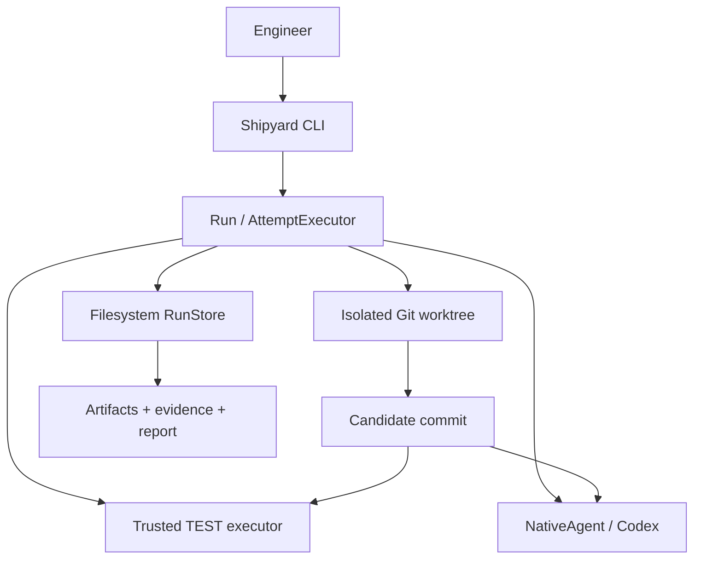
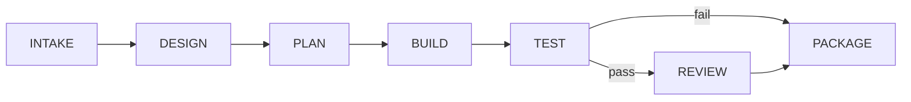
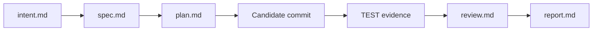
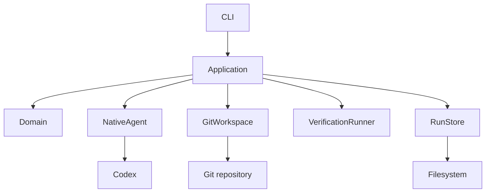

# Shipyard Architecture

This document describes the **Shipyard PoC** architecture. MVP and Product architecture are intentionally out of scope.

Phase 2 intake and frozen Run contracts are complete; see the
[acceptance audit](spec/018-phase2-acceptance-audit/report.md). Engine and delivery
execution remain later-phase work.

## Bird's Eye View

Shipyard is a local, synchronous CLI application. It accepts a Markdown file or GitHub Issue, freezes the Run contract, executes one canonical playbook around a native coding agent, verifies the resulting Git commit, and writes durable evidence to the local filesystem.



## Technology choices

The PoC intentionally uses a small local stack:

- Python 3.14
- `uv` for dependency and environment management
- Typer + Rich for the CLI
- Pydantic for structured domain and stage contracts
- PyYAML for `shipyard.yaml`
- system `git` and external tools via subprocess
- Codex CLI behind the `NativeAgent` boundary
- filesystem-backed persistence
- pytest, Ruff, and Pyright for validation

No web framework, database, background worker system, or cloud infrastructure is part of the PoC.

## Architecture Invariants

1. The PoC has one playbook: `bounded-repository-change`.
2. Its stages are `INTAKE → DESIGN → PLAN → BUILD → TEST → REVIEW → PACKAGE`.
3. DESIGN, PLAN, BUILD, and REVIEW use fresh native-agent invocations.
4. `spec.md` is the correctness contract; `plan.md` is implementation guidance.
5. BUILD may update the plan but may not silently rewrite the spec.
6. BUILD produces an exact candidate Git commit before TEST.
7. Verification belongs to the exact candidate SHA.
8. TEST is Shipyard-controlled and authoritative. Any mandatory failure produces `TEST_FAILED`; REVIEW does not run.
9. REVIEW is independent, read-only, and evaluates the exact candidate against `spec.md` and TEST evidence.
10. Required criteria are `PASS`, `FAIL`, or `UNVERIFIED`. Only all-`PASS` can produce `VERIFIED`.
11. Workflow state comes from validated structured stage results, never prose inference.
12. The Run freezes input intent, base SHA, playbook/skills, verification configuration, agent profile, and execution budget.
13. `shipyard.yaml` is read from the frozen base revision; BUILD cannot change how its candidate is judged.
14. The PoC is trusted-local. Git worktrees isolate workspace state but are not a security boundary.
15. Every terminal result produces `report.md` and machine-readable evidence.
16. Terminal Run directories are immutable.

## Execution Flow



| Stage | Responsibility | Main output |
|---|---|---|
| INTAKE | Freeze source intent | `intent.md` |
| DESIGN | Define what must be true | `spec.md` + stage result |
| PLAN | Define implementation approach | `plan.md` + stage result |
| BUILD | Implement and create candidate commit | candidate SHA + stage result |
| TEST | Run all mandatory `shipyard.yaml` checks | deterministic evidence |
| REVIEW | Independently assess required criteria | `review.md` + stage result |
| PACKAGE | Finalize human and machine evidence | `report.md`, `evidence.json` |

PACKAGE is outside the normal execution budget and runs for every terminal outcome.

## Input and CLI

Supported inputs:

```text
file:./issue.md
github:owner/repo#42
```

Intake commands available in Phase 2:

```text
shipyard intake file:./issue.md --settings ./operator.yaml
shipyard intake github:owner/repo#42 --settings ./operator.yaml
shipyard inspect <run-id>
```

Additional intake options:

```text
--repo
--ref
--timeout
--verification-reserve
--runs-dir
```

The CLI prints complete contract JSON and leaves captures in CREATED. Full workflow
execution and `shipyard run` remain future work. Methodology content is frozen here;
Phase 3 owns its engine/composition semantics.

GitHub Issue intake uses the developer's local authenticated `gh` environment.

The CLI owns command parsing, local configuration, terminal rendering, and exit codes. It does not own workflow or verification rules.

## Core Artifact Chain



Artifacts, not agent-session continuity, carry state between stages.

The candidate remains reachable through a Shipyard-owned ref such as:

```text
refs/shipyard/runs/<run-id>/candidate
```

## Code Map

```text
src/shipyard/
├── cli/            # CLI entry point and presentation
├── domain/         # Run, Attempt, Candidate, outcomes, frozen contract
├── application/    # durable intake; AttemptExecutor planned
├── intake/         # local Markdown and authenticated gh capture
├── configuration/  # operator settings and methodology content capture
├── playbooks/      # bounded-repository-change
├── skills/         # built-in Markdown skills
├── agents/         # NativeAgent boundary and Codex adapter
├── git/            # commit resolution; worktrees/candidate operations planned
├── verification/   # frozen shipyard.yaml; trusted TEST execution planned
├── review/         # semantic review result handling
├── evidence/       # evidence model and PACKAGE/report generation
└── persistence/    # create-only intent and complete Run captures
```

### `domain`

Owns stable product concepts:

```text
Run
Attempt
RunContract
Candidate
StageResult
IntentSnapshot
RunOutcome
FailureReason
ExecutionBudget
```

**Invariant:** domain code does not depend on CLI, Codex-specific details, GitHub transport, or filesystem layout.

The implemented `RunContract` is a frozen execution contract, separate from
Run lifecycle state. It composes existing `run_id`, `IntentSnapshot`, `base_sha`,
`VerificationConfigSnapshot`, and `ExecutionSnapshot`, rejecting mismatched intent
ownership or verification base SHA. Construction performs no I/O and generates no identities.
Existing Pydantic JSON APIs preserve values and serialize equivalent validated
inputs deterministically, including their existing identities. Matching provenance
is a consistency check; committed-content reading remains the loader's job.

Execution snapshots require actual methodology text with SHA-256 digests, explicit
names/versions, a canonical playbook, unique skill names, an agent profile,
trusted-local policy and a budget with a verification reserve. They declare future
execution inputs without implementing the engine, skill composition or execution.
Intake orchestration and CLI persist these inputs, completing the Phase 2 frozen
contract. This record alone does not execute a Run.

### `intake`

The Markdown adapter resolves a local path, reads bytes once, strictly decodes
UTF-8, and returns a validated in-memory `IntentSnapshot`. It preserves the source
text, including front matter, BOM, and line endings, and records resolved source
provenance. Filesystem/decoding failures retain their causes in
`MarkdownIntakeError`.

The snapshot has no live dependency on the source file. The adapter performs no
writes or Run transitions; the intent store handles persistence separately.
Common source dispatch accepts file and GitHub selectors. GitHub captures title,
body and labels once through authenticated gh, normalizing title/sorted label names
and preserving body text. Comments are excluded. Optional local front matter stays
source text; no schema is imposed. Source and target repositories are independent.

### `configuration`

Operator YAML is loaded into a complete immutable execution snapshot. Methodology
paths resolve beside the settings file and exact UTF-8 content is hashed. Safe
unique-key YAML parsing is shared with verification configuration. Budget cannot
be specified in YAML: Shipyard supplies defaults or an explicit application budget.
No new execution-semantic project settings are supported by this PoC beyond the
base-revision verification configuration.

### `application`

The implemented `create_run` composes source capture, one base resolution, committed
verification loading and complete contract storage through explicit parameters. It
returns a durable CREATED capture without agent/check execution. Non-CREATED
inputs and capture failures are rejected. The planned `AttemptExecutor` will
execute the canonical playbook and enforce transitions, budgets and outcomes.

### `playbooks` / `skills`

Playbooks decide **which stages run**. The implemented immutable
`PlaybookDefinition` fixes all seven stages, predecessor dependencies, executor
authority, fresh agent invocation, read-only REVIEW and PACKAGE outside budget.
The `canonical_playbook` factory requires an explicit version. These declarations
do not execute stages. Skills provide **stage-specific guidance** and contain no
executable hooks in the PoC.

### `agents`

Defines the `NativeAgent` boundary. Codex is the first adapter.

**Invariant:** vendor-specific behavior stays behind `NativeAgent`.

### `git`

The implemented `GitRepository` resolves a supplied repository's committed HEAD
or explicit native Git commit-ish to a full validated SHA. It invokes system Git
via a subprocess argument list with commit peeling and option termination.
Repository-scoped environment overrides are cleared in a copy, normal configuration
is preserved, and optional locking is disabled. The adapter performs no checkout,
fetch, reset, commit, or ref update and preserves dirty developer state.

Each call resolves afresh. Run creation must call once and persist
the resulting immutable base SHA. Workspace/candidate operations remain planned.

`read_file_at_commit` reads repository-root-relative blob bytes at a validated
actual commit SHA without consulting mutable refs or checkout files. Git replacement
handling is disabled for object type/content reads so the requested original
commit cannot silently supply replacement configuration. Read failures preserve
their causes in `GitReadError`.

The full Git boundary will own:

- base ref resolution to immutable `base_sha`;
- isolated worktree creation;
- candidate commit creation;
- candidate ref management.

Local uncommitted developer state is ignored.

### `verification`

The implemented loader reads root `shipyard.yaml` from an exact supplied base SHA,
parses UTF-8 YAML using safe unique-key mappings, and validates frozen domain
settings. Version 1 contains only ordered checks with unique IDs and nonblank
command strings; all checks are mandatory. Snapshots retain the base SHA and
source-byte SHA-256 without source text, generated identities, or timestamps.

Missing/invalid configuration or zero checks raises `VerificationConfigError`
synchronously. Trusted TEST execution and mapping failures to Run
`CONFIGURATION_ERROR` before agent invocation remain planned.

**Invariant:** model output can never override a failed trusted check.

### `evidence` / `persistence`

The PoC uses filesystem-only persistence:

```text
~/.shipyard/runs/<run-id>/
├── run.json
├── contract.json
├── events.jsonl
├── evidence.json
├── intent.md
├── intent.json
├── spec.md
├── plan.md
├── review.md
├── report.md
└── logs/
```

Terminal Run directories are immutable.

The implemented `FileIntentStore` persists captured intent under an explicit
Runs root. `intent.md` holds exact UTF-8 bytes; `intent.json` holds only source
reference and artifact metadata. Loading validates the metadata, content identity,
and requested Run ownership through the existing domain contracts without reading
the original issue.

Intent saves create files exclusively and reject either reserved path if present.
The content file is closed before metadata creation. Partial files are retained
on failure and rejected by subsequent load/save operations. This is create-only
intent persistence, without atomic multi-file publication or power-loss guarantees.
General RunStore behavior, event persistence, and terminal-directory enforcement
remain planned.

`FileRunStore` exclusively reserves a fresh Run directory and composes the intent
store with CREATED run.json and complete contract.json. The contract is written
last. Loading requires valid records with matching ownership and identical intent.
Incomplete directories are retained, rejected on load and never overwritten on
save. This supports durable Phase 2 intake; general Run lifecycle/event persistence
and terminal-directory enforcement remain future work.

## Boundaries



Primary ports:

```text
NativeAgent
GitWorkspace
VerificationRunner
RunStore
```

Infrastructure-specific behavior stays behind these boundaries.

## Cross-Cutting Concerns

### Execution budget

A Run has one frozen budget. PACKAGE does not consume it.

### Stage contracts

Each agent stage produces a human-readable artifact and a validated structured stage result. Invalid structured output produces `INVALID_STAGE_OUTPUT`; Shipyard does not repair or infer it from prose.

### Evidence

Evidence records the frozen intent, base SHA, candidate SHA, checks and results, acceptance-criterion coverage, agent/methodology/configuration provenance, and explicit unverified areas. Private model reasoning and unbounded transcripts are not required.

### Outcomes

Completed software outcomes are:

```text
VERIFIED
NEEDS_CLARIFICATION
NEEDS_RESCOPING
TEST_FAILED
CHANGES_REQUIRED
```

Execution failures remain distinct from software outcomes.
