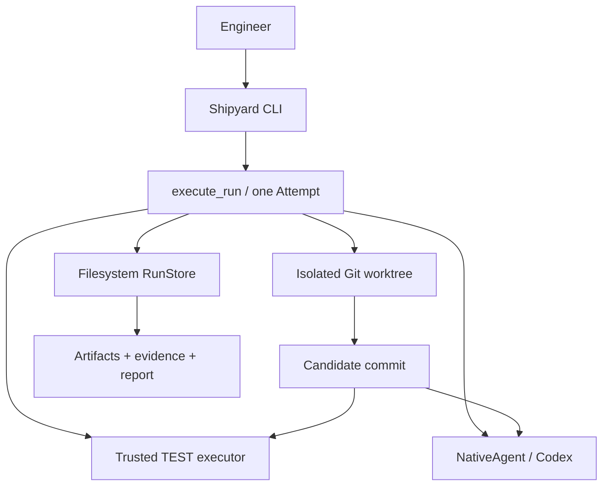
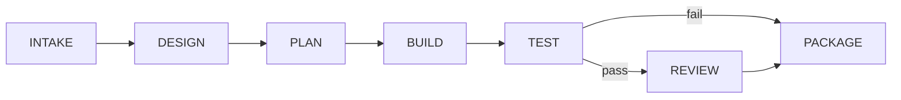
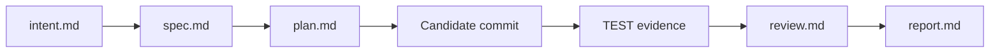
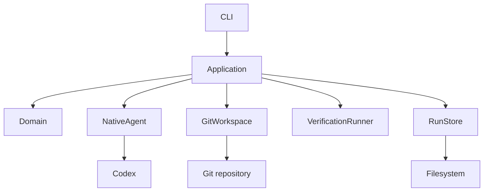

# Shipyard Architecture

This document describes the **Shipyard PoC** architecture. MVP and Product architecture are intentionally out of scope.

Phases 2–8 are complete: frozen intake, methodology/routing, independent
native-agent execution, Git candidates, trusted TEST, revision-bound REVIEW/VERIFIED,
and synchronous Run execution with terminal PACKAGE.
See the [Phase 8 audit](spec/045-phase8-acceptance-audit/report.md).

## Bird's Eye View

Shipyard is a local, synchronous CLI application. It accepts a Markdown file or GitHub Issue, freezes the Run contract, executes one canonical playbook around a native coding agent, verifies the resulting Git commit, and writes durable evidence to the local filesystem.



## Technology choices

The PoC intentionally uses a small local stack:

- Python 3.14
- `uv` for dependency and environment management
- Typer + Rich for the CLI
- Pydantic for structured domain and stage contracts
- PyYAML for `shipyard.yaml`
- system `git` and external tools via subprocess
- Codex CLI behind the `NativeAgent` boundary
- filesystem-backed persistence
- pytest, Ruff, and Pyright for validation

No web framework, database, background worker system, or cloud infrastructure is part of the PoC.

## Architecture Invariants

1. The PoC has one playbook: `bounded-repository-change`.
2. Its stages are `INTAKE → DESIGN → PLAN → BUILD → TEST → REVIEW → PACKAGE`.
3. DESIGN, PLAN, BUILD, and REVIEW use fresh native-agent invocations.
4. `spec.md` is the correctness contract; `plan.md` is implementation guidance.
5. BUILD may update the plan but may not silently rewrite the spec.
6. BUILD produces an exact candidate Git commit before TEST.
7. Verification belongs to the exact candidate SHA.
8. TEST is Shipyard-controlled and authoritative. Any mandatory failure produces `TEST_FAILED`; REVIEW does not run.
9. REVIEW is independent, read-only, and evaluates the exact candidate against `spec.md` and TEST evidence.
10. Required criteria are `PASS`, `FAIL`, or `UNVERIFIED`. Only all-`PASS` can produce `VERIFIED`.
11. Workflow state comes from validated structured stage results, never prose inference.
12. The Run freezes input intent, base SHA, playbook/skills, verification configuration, agent profile, and execution budget.
13. `shipyard.yaml` is read from the frozen base revision; BUILD cannot change how its candidate is judged.
14. The PoC is trusted-local. Git worktrees isolate workspace state but are not a security boundary.
15. Every terminal result produces `report.md` and machine-readable evidence.
16. Terminal Run directories are immutable.

## Execution Flow



| Stage | Responsibility | Main output |
|---|---|---|
| INTAKE | Freeze source intent | `intent.md` |
| DESIGN | Define what must be true | `spec.md` + stage result |
| PLAN | Define implementation approach | `plan.md` + stage result |
| BUILD | Implement and create candidate commit | candidate SHA + stage result |
| TEST | Run all mandatory `shipyard.yaml` checks | deterministic evidence |
| REVIEW | Independently assess required criteria | `review.md` + stage result |
| PACKAGE | Finalize human and machine evidence | `report.md`, `evidence.json` |

PACKAGE is outside the normal execution budget and runs for every terminal outcome.

## Input and CLI

Supported inputs:

```text
file:./issue.md
github:owner/repo#42
```

Intake commands available in Phase 2:

```text
shipyard intake file:./issue.md --settings ./operator.yaml
shipyard intake github:owner/repo#42 --settings ./operator.yaml
shipyard inspect <run-id>
shipyard methodology <run-id> [--stage build]
```

Additional intake options:

```text
--repo
--ref
--timeout
--verification-reserve
--runs-dir
```

Intake prints complete contract JSON and leaves captures in CREATED.
`shipyard run <run-id> --repo <repository>` executes one captured Run synchronously
and prints terminal JSON plus report/evidence paths. Methodology content is frozen here;
Phase 3 compilation and routing validate its topology and skill scope. The
methodology command previews frozen metadata/guidance without execution or writes.

GitHub Issue intake uses the developer's local authenticated `gh` environment.

The CLI owns command parsing, local configuration, terminal rendering, and exit codes. It does not own workflow or verification rules.

## Core Artifact Chain



Artifacts, not agent-session continuity, carry state between stages.

The candidate remains reachable through a Shipyard-owned ref such as:

```text
refs/shipyard/runs/<run-id>/candidate
```

## Code Map

```text
src/shipyard/
├── cli/            # CLI entry point and presentation
├── domain/         # Run, Attempt, Candidate, outcomes, frozen contract
├── application/    # durable intake, synchronous Run executor and native stages
├── intake/         # local Markdown and authenticated gh capture
├── configuration/  # operator settings and methodology content capture
├── playbooks/      # frozen document compiler and packaged canonical playbook
├── skills/         # stage guidance composition and packaged engineering skill
├── agents/         # NativeAgent boundary and Codex adapter
├── git/            # commit resolution; isolated worktrees and candidate publication
├── verification/   # frozen shipyard.yaml and sequential trusted checks
├── review/         # semantic review result handling
├── evidence/       # evidence model and PACKAGE/report generation
└── persistence/    # frozen captures and exclusive lifecycle journals
```

### `domain`

Owns stable product concepts:

```text
Run
Attempt
RunContract
Candidate
StageResult
IntentSnapshot
RunOutcome
FailureReason
ExecutionBudget
```

**Invariant:** domain code does not depend on CLI, Codex-specific details, GitHub transport, or filesystem layout.

The implemented `RunContract` is a frozen execution contract, separate from
Run lifecycle state. It composes existing `run_id`, `IntentSnapshot`, `base_sha`,
`VerificationConfigSnapshot`, and `ExecutionSnapshot`, rejecting mismatched intent
ownership or verification base SHA. Construction performs no I/O and generates no identities.
Existing Pydantic JSON APIs preserve values and serialize equivalent validated
inputs deterministically, including their existing identities. Matching provenance
is a consistency check; committed-content reading remains the loader's job.

Execution snapshots require actual methodology text with SHA-256 digests, explicit
names/versions, a canonical playbook, unique skill names, an agent profile,
trusted-local policy and a budget with a verification reserve. They declare frozen
inputs consumed by the Phase 3 methodology compiler and guidance/routing layers;
the snapshot itself performs no engine logic or executor invocation.
Intake orchestration and CLI persist these inputs, completing the Phase 2 frozen
contract. This record alone does not execute a Run.

### `intake`

The Markdown adapter resolves a local path, reads bytes once, strictly decodes
UTF-8, and returns a validated in-memory `IntentSnapshot`. It preserves the source
text, including front matter, BOM, and line endings, and records resolved source
provenance. Filesystem/decoding failures retain their causes in
`MarkdownIntakeError`.

The snapshot has no live dependency on the source file. The adapter performs no
writes or Run transitions; the intent store handles persistence separately.
Common source dispatch accepts file and GitHub selectors. GitHub captures title,
body and labels once through authenticated gh, normalizing title/sorted label names
and preserving body text. Comments are excluded. Optional local front matter stays
source text; no schema is imposed. Source and target repositories are independent.

### `configuration`

Operator YAML is loaded into a complete immutable execution snapshot. Methodology
paths resolve beside the settings file and exact UTF-8 content is hashed. Safe
unique-key YAML parsing is shared with verification configuration. Budget cannot
be specified in YAML: Shipyard supplies defaults or an explicit application budget.
No new execution-semantic project settings are supported by this PoC beyond the
base-revision verification configuration.

### `application`

The implemented `create_run` composes source capture, one base resolution, committed
verification loading and complete contract storage through explicit parameters. It
returns a durable CREATED capture without agent/check execution. Non-CREATED
inputs and capture failures are rejected. New intake compiles all frozen
methodology before external I/O, rejecting legacy plain assets or weakened topology.
Historical captures remain inspectable without being silently migrated. The
implemented `execute_stage` invokes one injected NativeAgent using durable
upstream artifacts and frozen methodology. It writes create-only per-stage
captures with a manifest last, rejects upstream mutation, and requires a complete
matching trusted TEST capture and successful receipt plus clean exact-candidate
workspace for REVIEW. It returns a validated REVIEW decision without advancing
lifecycle or routing. `execute_run` composes these stages with Git workspaces,
candidate publication, trusted TEST, shared monotonic budget accounting, validated
routing, lifecycle/event persistence and PACKAGE. Early software outcomes, failed
checks, invalid output, provider failures, cancellation and budget exhaustion each
produce an explicit terminal state. Unexpected executor exceptions produce
INTERNAL_ERROR. Failed TEST never invokes REVIEW. PACKAGE runs outside admission
checks. The executor preserves workspaces and rejects any second admission;
there is no retry/recovery or background service.

### `playbooks` / `skills`

Playbooks decide **which stages run**. The implemented immutable
`PlaybookDefinition` fixes all seven stages, predecessor dependencies, executor
authority, fresh agent invocation, read-only REVIEW and PACKAGE outside budget.
The `canonical_playbook` factory requires an explicit version. These declarations
do not execute stages. Skills provide **stage-specific guidance** and contain no
executable hooks in the PoC.

Methodology compilation reads only frozen asset content. Validated YAML front
matter binds playbook identity/topology or skill identity/description/agent-stage
scope. Unknown skill control fields are rejected; opaque body prose has no
workflow authority. Content-bound identities include exact source SHA-256.
Legacy Phase 2 plain Markdown is inspectable, but cannot compile as methodology
without an explicit front-matter migration.

`compile_methodology` parses a frozen execution snapshot; `compose_guidance` filters
skills by native-agent stage in configured order and returns immutable sections
with exact content/provenance. Shipyard-owned stages do not receive composed agent
skills. Guidance cannot add steps, dependencies, executors or hooks; provider prompt
formatting and execution are implemented by the Phase 4 Codex adapter.

`PlaybookExecution` is a pure immutable routing engine bound to one Attempt.
Validated harness receipts advance only the next canonical stage. BUILD binds the
Candidate; TEST and REVIEW must retain its exact identity. Failures and early exits
route to PACKAGE; a failed TEST cannot reach REVIEW. PACKAGE ends routing even on
failure. History is validated again on JSON reload. This does not prove executor
success, run checks, enforce elapsed budget or grant a Run outcome.

Version 1 canonical playbook and engineering skill Markdown are packaged resources.
`load_default_methodology` captures and validates them independently of cwd.
Operators still explicitly choose their agent profile; default adoption never
mutates a previously captured Run.

### `review` / verification gate

`extract_criteria` reads explicit `AC-NNN: text` declarations (also Markdown list
items or headings with an em dash), ignoring fenced examples and prose references.
Every declared criterion is required. Empty/duplicate declarations fail closed;
`SpecificationReference` binds unique IDs to exact spec UTF-8 SHA-256.

REVIEW preflight reconciles complete TEST captures with frozen check configuration,
ordered commands, identities and computed success; receipts alone are insufficient.
`evaluate_review` requires exact candidate and spec coverage. Any FAIL/UNVERIFIED
produces CHANGES_REQUIRED; all PASS plus successful TEST produces a domain
`VerificationRecord`. The stage manifest captures that decision and TEST digest,
alongside review.md and structured results. Invalid coverage leaves no success
manifest. Failed TEST blocks invocation.

`Run.complete` accepts VERIFIED only with matching verification. The immutable
record checks Run/Attempt/candidate ownership, complete passing check evidence and
exact all-PASS criterion coverage, also on JSON reload. No evidence transfers to a
new SHA. This is trusted-local consistency validation, not authentication of
arbitrary files or proof of the reviewer's semantic correctness. The synchronous executor owns lifecycle
persistence and orchestration; lower-level stage APIs retain explicit caller ownership.

### `agents`

`NativeAgent.execute(AgentRequest)` is a small synchronous port with no session
continuity API. Requests carry stage, workspace, frozen profile/guidance, upstream
text, remaining seconds and REVIEW candidate; outputs separate process status
from structured final JSON. Parsing reuses existing stage contracts and rejects
missing Markdown, wrong stages, foreign candidates and unauthorized plan changes.

`CodexAgent` uses one fresh ephemeral `codex exec` subprocess per invocation with
explicit model, workspace, sandbox and schema. It reads only the final message,
not stdout, and bounds its size. Read-only stages return Markdown inside JSON for
Shipyard to persist. BUILD uses workspace-write. Profile arguments cannot override
harness controls; only reasoning-effort config pairs are initially supported.
Timeouts terminate the process group best-effort; temporary files are cleaned.
The shared subprocess capture drains pipes while retaining a 64 KiB prefix per
stream, flags truncation, and closes inherited pipes without waiting for detached
descendants. Diagnostics survive nonzero exits and deadlines in partial captures.
Optional validated usage belongs to the NativeAgent response, never the agent
output envelope; the Codex adapter currently reports no usage/billing counters.
Authentication stays in the local Codex environment; no live-provider smoke test
is claimed by the synthetic process integration suite.

**Invariant:** vendor-specific behavior stays behind `NativeAgent`.

### `git`

The implemented `GitRepository` resolves a supplied repository's committed HEAD
or explicit native Git commit-ish to a full validated SHA. It invokes system Git
via a subprocess argument list with commit peeling and option termination.
Repository-scoped environment overrides are cleared in a copy, normal configuration
is preserved, and optional locking is disabled. The resolution operation performs no checkout,
fetch, reset, commit, or ref update and preserves dirty developer state.

Each call resolves afresh. Run creation must call once and persist
the resulting immutable base SHA. Workspace/candidate operations are described below.

`read_file_at_commit` reads repository-root-relative blob bytes at a validated
actual commit SHA without consulting mutable refs or checkout files. Git replacement
handling is disabled for object type/content reads so the requested original
commit cannot silently supply replacement configuration. Read failures preserve
their causes in `GitReadError`.

The implemented Git boundary owns:

- base ref resolution to immutable `base_sha`;
- isolated worktree creation;
- candidate commit creation;
- candidate ref management.

`require_clean_revision` provides a read-only pre/post REVIEW assertion for an
existing checkout at the exact candidate SHA, rejecting tracked, untracked and
ignored workspace changes. It performs no checkout or candidate creation.

`create_workspace(attempt, path)` creates a fresh detached worktree at the exact
Attempt start SHA outside the source checkout. `GitWorkspace.publish_candidate()`
requires unchanged detached HEAD, stages BUILD changes and creates a commit with
explicit harness identity, disabled hooks/signing and a clean-revision assertion.
Ignored residue is rejected rather than removed. The Run-owned candidate ref is
published with atomic create-only update-ref; existing refs cannot be overwritten.
Failures retain partial state for inspection. Replacement objects are disabled.
The caller validates ownership and BUILD success; no lifecycle grant is implied.
Workspaces require exclusive sequential use; cleanup and retry remain caller-owned.

Local uncommitted developer state is ignored.

### `verification`

The implemented loader reads root `shipyard.yaml` from an exact supplied base SHA,
parses UTF-8 YAML using safe unique-key mappings, and validates frozen domain
settings. Version 1 contains only ordered checks with unique IDs and nonblank
command strings; all checks are mandatory. Snapshots retain the base SHA and
source-byte SHA-256 without source text, generated identities, or timestamps.

Missing/invalid configuration or zero checks raises `VerificationConfigError`
synchronously. `run_checks` executes every frozen command through the local POSIX shell,
collecting exit status, timeout/launch errors and file logs without fail-fast.
`application.execute_test` guards exact candidate cleanliness before and after
execution, persists configuration/results/receipt with a manifest last, and emits
TEST_FAILED on check failure or post-check workspace changes. It does not reread
candidate configuration. Callers still own total budget accounting and lifecycle
mapping, including configuration failures to Run `CONFIGURATION_ERROR`. The synchronous executor supplies one shared TEST
deadline: after exhaustion remaining checks are recorded without invocation.
Log truncation does not affect check success.

**Invariant:** model output can never override a failed trusted check.

### `evidence` / `persistence`

The PoC uses filesystem-only persistence:

```text
~/.shipyard/runs/<run-id>/
├── run.json
├── contract.json
├── events.jsonl
├── evidence.json
├── intent.md
├── intent.json
├── attempt.json
├── timing.json
├── stage-timings.json
├── design/         # spec.md, structured result, bounded diagnostics, manifest
├── plan/           # plan.md and stage capture
├── build/          # optional plan.md update and stage capture
├── test/           # complete check manifest and bounded numbered logs
├── review/         # review.md, validated decision and stage capture
└── report.md
```

Terminal Run directories are immutable.

The implemented `FileIntentStore` persists captured intent under an explicit
Runs root. `intent.md` holds exact UTF-8 bytes; `intent.json` holds only source
reference and artifact metadata. Loading validates the metadata, content identity,
and requested Run ownership through the existing domain contracts without reading
the original issue.

Intent saves create files exclusively and reject either reserved path if present.
The content file is closed before metadata creation. Partial files are retained
on failure and rejected by subsequent load/save operations. This is create-only
intent persistence, without atomic multi-file publication or power-loss guarantees.
The Run store separately owns lifecycle journal persistence and exclusive execution admission.

`FileRunStore` exclusively reserves a fresh Run directory and composes the intent
store with CREATED run.json and complete contract.json. The contract is written
last. Loading requires valid records with matching ownership and identical intent.
Incomplete directories are retained, rejected on load and never overwritten on
save. `begin` exclusively reserves `.execution`, records CREATED/RUNNING events
and updates the Run snapshot. `finish` appends one terminal event and replaces
run.json, requiring matching frozen verification before VERIFIED persistence.
Reload replays validated lifecycle events and rejects snapshot disagreement.
Terminal Runs cannot be re-admitted or finalized again. Journal/snapshot updates
are not transactionally atomic; interrupted writes fail closed and remain
inspectable. OS permissions do not protect against other local writers.

`package_run` reserves `.package` and writes report.md followed by evidence.json.
It records frozen provenance, exact candidate, check results, criterion coverage,
timing, optional provider usage/actual charge and explicit missing evidence.
The index hashes prior regular files with relative paths and sizes, including the
report but excluding itself; symlinks are rejected. VERIFIED packaging reconciles
DESIGN/TEST/REVIEW against the terminal verification record. No model participates
in packaging and no execution allowance is required. Disk errors are surfaced;
partial PACKAGE is retained and cannot be silently retried.

## Boundaries



Primary ports:

```text
NativeAgent
GitWorkspace
VerificationRunner
RunStore
```

Infrastructure-specific behavior stays behind these boundaries.

## Cross-Cutting Concerns

### Execution budget

A Run has one frozen budget. `BudgetClock` uses monotonic elapsed time from
execution admission; DESIGN/PLAN/BUILD cannot consume the verification reserve.
TEST/REVIEW share the remaining total. Stage timing survives ordinary failures;
PACKAGE records its timing separately and does not consume execution allowance.
Remaining subsecond allowance cannot admit a native-agent call. UTC wall-clock
timestamps describe events; elapsed monotonic time controls deadlines.

### Stage contracts

Each agent stage produces a human-readable artifact and a validated structured stage result. Invalid structured output produces `INVALID_STAGE_OUTPUT`; Shipyard does not repair or infer it from prose.

### Evidence

Evidence records the frozen intent, base SHA, candidate SHA, checks and results, acceptance-criterion coverage, agent/methodology/configuration provenance, and explicit unverified areas. Private model reasoning and unbounded transcripts are not required.

### Outcomes

Completed software outcomes are:

```text
VERIFIED
NEEDS_CLARIFICATION
NEEDS_RESCOPING
TEST_FAILED
CHANGES_REQUIRED
```

Execution failures remain distinct from software outcomes.
