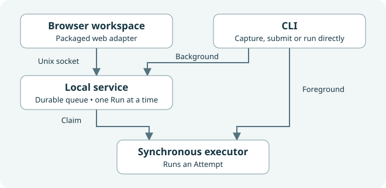
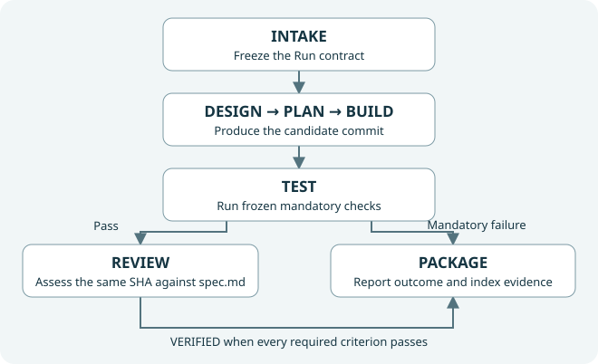
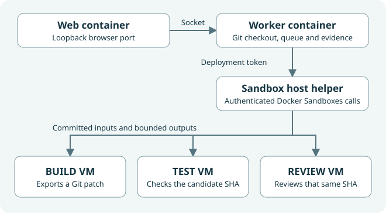
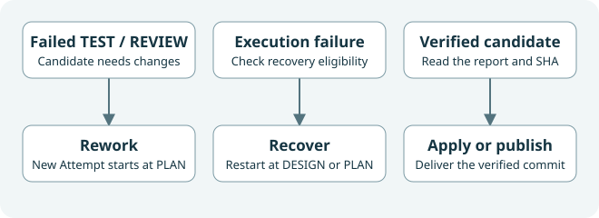

# Harborist system design

Harborist is a local, single-user system designed for Unix-based environments.
It turns an engineering request into a Git commit with traceable verification. The CLI and browser workspace
use a local service to queue work and inspect results. The service runs one
Run at a time through the synchronous execution core. The CLI can also
invoke that core directly in foreground mode.

## Submit, inspect, and act on a Run

1. **Choose a request and target.** In the browser, open **New Run**, choose
   a saved Workspace, enter the request, and select **Queue Run**. For a
   GitHub issue, use **Ticket Inbox**, load issues from the source
   repository, and select the issue and target Workspace.
2. **Follow the Run.** Open it from the Runs list. Read the delivery state
   to see whether the worker has claimed or finished it. Then check the
   selected Attempt's outcome and candidate SHA.
3. **Inspect the evidence.** Open the report, mandatory checks, and review
   findings. A `FINISHED` delivery can contain a failed check.
4. **Choose the next action.** Apply or publish a verified candidate. Rework
   a candidate that failed checks or review. Recover an eligible execution
   interruption. Each continuation creates a fresh Attempt.

From an installed CLI with the service running, submit a request and use the
UUID printed by the first command as `RUN_ID` in the second:

```bash
harborist run file:./request.md --repo /path/to/repository
harborist status RUN_ID --wait
```

For the container deployment, use `./deploy/harborist exec` in place of
`harborist` and paths accessible to the worker. See the
[Docker quickstart](quickstart.md) for a complete setup.

## How requests reach the executor



| Component | Responsibility |
| --- | --- |
| CLI | Captures local Markdown or a GitHub Issue, submits saved Runs, and exposes inspection and delivery commands. |
| Browser workspace | Serves a packaged React interface through the local web adapter. It reads Run history and evidence and offers explicit actions for intake, continuation, cancellation, and GitHub delivery. |
| Local service | Receives requests over a Unix socket, owns queue admission and delivery, and invokes the executor for each claimed Run. |
| Execution core | Routes the workflow, invokes Codex through the native-agent adapter, creates Git candidates, runs trusted checks, and packages results. |
| Filesystem and Git | The filesystem holds frozen inputs, queue records, and Attempt evidence. Git retains candidate commits through Harborist-owned refs. |

The browser adapter forwards allowlisted requests to the service. It
validates the request host and applies same-origin and cross-site request
forgery checks to write requests. Evidence is served through named, bounded
reads. Closing the browser leaves the worker running.

A saved Workspace supplies repository and execution defaults for new
captures. The GitHub ticket Inbox can use an issue from one repository as
the request for a Run against a different target Workspace. Intake fetches
the issue again and saves its contents. GitHub operations require an
authenticated GitHub CLI in the environment performing them. The stock
Compose worker image ships Git and requires separate provisioning for
GitHub CLI operations. See [service operation](background-control-plane.md)
and [Run submission](usage.md#submit-a-run).

## What a Run freezes



Intake saves the request, base commit, playbook and skill contents, agent
profile, execution policy, mandatory checks, and time budget in the Run
contract. Harborist reads the mandatory checks from the base revision's
repository configuration. This prevents a candidate from changing the
checks used to judge itself. Workspace settings changes apply to future
captures.

An Attempt is one execution of that Run. The normal sequence is
**INTAKE → DESIGN → PLAN → BUILD → TEST → REVIEW → PACKAGE**. Intake creates
the contract before execution is submitted. Each of DESIGN, PLAN, BUILD,
and REVIEW starts a fresh agent invocation. The stages pass durable
artifacts and validated structured results between invocations. DESIGN
writes the acceptance contract in `spec.md`, PLAN writes implementation
guidance in `plan.md`, and BUILD can revise the plan while preserving the
specification.

Queue wait is outside the execution budget. DESIGN, PLAN, and BUILD leave a
reserved portion for verification. TEST and REVIEW share the remaining
time. PACKAGE records its own time and preserves the terminal result and
available evidence when packaging can run. See [Workflow and
verification](methodology.md) and [Budget
accounting](configuration.md#budget-accounting).

## Where code executes



| Execution policy | Environment |
| --- | --- |
| Trusted local | Agent stages and mandatory checks run where the executor runs. Harborist uses isolated Git worktrees to protect checkout state. Use this mode with trusted repositories and commands because worktrees share the executor's OS permissions. |
| Docker Sandboxes | Each agent stage and TEST receives a fresh VM with no repository mount. Harborist imports committed Git state and passes explicit inputs across the boundary. BUILD exports a bounded patch, and system Git creates the candidate in the executor's worktree. Harborist retains a candidate bundle and loads that same commit into separate TEST and REVIEW VMs. |

Deployment and execution policy are independent. In the local container
deployment, Docker Compose runs the worker and browser adapter in two
Linux containers from the same non-root image. The browser port is published on
loopback. A shared volume carries the control socket, and the worker keeps
its Run state and repositories in persistent storage.

For Docker Sandboxes in this deployment, the worker calls an authenticated
helper on the host running Docker Sandboxes. The helper invokes the host’s
`sbx` command, allowlists operations, and validates sandbox ownership. Git bundles and artifacts cross the VM boundary
through standard input and output. The containers have no Docker Engine socket. Intake
fingerprints the machine's Docker Sandbox policy. If it changes before a
queued Run or continuation executes, Harborist rejects sandbox execution. See
[Docker Sandboxes execution](configuration.md#docker-sandboxes-execution).

Host deployment commands use Bash. The current `./deploy/harborist`
installer requires Apple silicon macOS with hardware virtualization. The [Docker quickstart](quickstart.md#before-you-begin)
covers that deployment. The host helper’s role and the Unix socket between
Harborist processes are part of the design.

## How verification follows the commit

BUILD yields a candidate identified by its Git SHA. Harborist runs the
frozen mandatory checks against that candidate. A failed mandatory check
produces `TEST_FAILED` and sends the Attempt to PACKAGE. After passing TEST,
an independent, read-only REVIEW checks the same SHA against `spec.md` and
the recorded TEST evidence. Every required criterion must be `PASS` for
`VERIFIED`. Agent-reported BUILD checks can inform REVIEW. Trusted TEST
evidence comes from Harborist's own check runner.

PACKAGE records the outcome in `report.md` and indexes the evidence in
`evidence.json`. Queue delivery, observed stage progress, terminal outcome,
and candidate verification each answer a different question. For example, a
`FINISHED` delivery can contain a `TEST_FAILED` outcome. Saved foreground
Runs can appear in history without a delivery record.

## How work continues after a failure



Rework starts at PLAN from a candidate packaged with `TEST_FAILED` or
`CHANGES_REQUIRED`. Recovery after an eligible execution failure begins at
DESIGN or PLAN, depending on the durable specification evidence available.
Both create a new Attempt under the original Run contract, account for
prior execution time and explicit grants, and retain earlier terminal
evidence. Each new candidate needs fresh TEST and REVIEW. If the worker loses a
claim, inspect the saved Attempt before requesting recovery.

For a failed mandatory check or review finding, open the failed Attempt,
read its evidence, and choose **Rework** with feedback about the failure.
For an eligible execution failure, choose **Recover**. Open the new Attempt
to follow its progress and use the Attempt history to revisit the earlier
result. If the request itself needs a different scope, capture a new Run.

From the CLI, choose the command that matches the outcome and then follow
the new Attempt with `harborist status RUN_ID --wait`. Replace `RUN_ID`
with the original Run's UUID.

| Outcome | Command |
| --- | --- |
| `TEST_FAILED` or `CHANGES_REQUIRED` | `harborist rework RUN_ID --feedback 'Fix the failing acceptance criterion'` |
| Eligible execution failure | `harborist recover RUN_ID` |

An interrupted worker claim requires an explicit time grant. See the
[recovery options](usage.md#rework-and-recovery) for eligibility and budget rules.

Cancellation and supersession are recorded at Run level and preserve the
historical Attempts. The worker cooperatively stops active work on
cancellation. Supersession links the original to a new capture and submits
the replacement through the same queue. See [Storage and
recovery](storage-and-recovery.md#attempt-history) and [Run
controls](usage.md#cancel-or-replace-a-run).

## How a verified candidate is delivered

Local application and GitHub publication are explicit operations after
PACKAGE. Both validate the packaged evidence against the selected Attempt
and its candidate ref. Local application advances an eligible local branch
and stores a receipt. GitHub publication pushes the approved SHA to a
dedicated branch, uses an expected-head lease to guard updates, and records
a publication receipt. GitHub checks, pull request feedback, and merge
status are recorded as GitHub observations. Harborist verification remains
attached to the SHA assessed by TEST and REVIEW.

To apply locally, use `harborist apply RUN_ID --branch BRANCH` with an
eligible existing branch. To publish to GitHub, copy the candidate SHA
from the Attempt report and approve that revision in the browser or CLI.
For a first publication, replace `RUN_ID`, `CANDIDATE_SHA`, `OWNER/REPO`,
and `PR_BASE` with your Run and destination details:

```bash
harborist publish RUN_ID --approve CANDIDATE_SHA --destination OWNER/REPO --base PR_BASE
```

After publication, inspect the recorded PR head and GitHub checks. You can
select recorded PR feedback for a new rework Attempt with fresh verification.

See [Apply a verified candidate](usage.md#apply-a-verified-candidate) and
[Publish a verified candidate to GitHub](usage.md#publish-a-verified-candidate-to-github).
For the code map and implementation contracts, see the [engineering
architecture](../ARCHITECTURE.md) and [developer reference](developer-reference.md).
